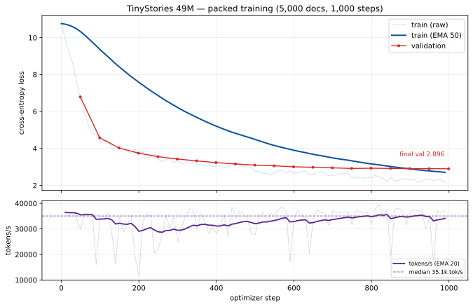

# PackBalance

[](https://github.com/DeKodez/packbalance/actions/workflows/ci.yml)

**Balance compute, not just tokens.**

PackBalance is a throughput-first LLM pretraining stack for variable-length documents. It packs documents into fixed-length sequences, then balances the *quadratic* attention cost of those packs across microbatches and DDP/FSDP ranks. The project includes the analytical thesis, a reproducible pre-GPU validation, GPU microbenchmarks, end-to-end training benchmarks, profiler reports, and correctness tests.

The headline result on a 25.4 GB Blackwell MIG slice:

| | padded baseline | packed + balanced | change |
|---|---:|---:|---:|
| useful tokens/s | **7,697** | **26,113** | **3.39×** |
| peak GPU memory | **9.57 GB** | **3.75 GB** | **2.55× lower** |
| padding waste | **71.9%** | **0.31%** | **71.6 pts less** |

Workload: 100M-parameter Llama-style model, 2048-token sequences, 20 timed steps after 5 warmup steps, synthetic heavy-tail document lengths, PyTorch 2.9.1 / CUDA 13.0 / Triton 3.5.1.

A real-data run is included too: a 49.3M-parameter model trained on 5,000 TinyStories documents for 1,000 steps goes from train loss **10.76 → 2.16** and validation loss **6.79 → 2.90**. [Loss curve](results/tinystories/loss_curve.svg).

## Why this exists

Naive batching pads every document to the longest document in its batch. On a heavy-tail corpus that is a large compute tax:

- **71.9%** of the tokens in the padded baseline are padding.
- Processing one *useful* token costs **3.78×** the forward FLOPs of a packed token.

Sequence packing removes the padding, but it creates a second problem: attention is `O(L²)` per *document*. A pack containing one 1024-token document and a pack containing eight 512-token documents both hold 4096 tokens, but the first pays roughly twice the attention FLOPs of the second. Token-balanced batching is not compute-balanced batching.

PackBalance addresses both:

1. **Packing** removes padding (best-fit-decreasing, with an optional cost-aware variant).
2. **Two-level scheduling** balances pack cost across steps and across ranks without any extra communication.
3. **Document-masked attention** makes packed training exact; documents never attend across boundaries.
4. **Fused kernels** reduce memory traffic and, for large LM heads, avoid materializing full logits.

## Pre-GPU validation

The intuition was tested before spending GPU money. All experiments are reproducible on CPU:

```bash
python -m packbalance.data.prepare --config configs/bench.yaml
python -m packbalance.profiling.prove_intuition --config configs/bench.yaml
# writes artifacts/thesis/report.md and artifacts/thesis/results.json
```

Verdicts from the CPU run:

| claim | verdict | evidence |
|---|---:|---|
| Padding is a material compute tax | supported | 71.9% waste; **3.78×** forward FLOPs per useful token |
| Attention has a quadratic term | supported | length-sweep fit **R²=1.000**; time(1024)/time(512)=**2.23×** |
| Analytical cost predicts measured time | supported | `time ~ 1 + cost` **R²=1.000** on the length sweep |
| Balanced scheduling reduces step tails | supported (step-level) | natural p99 **−2.3%**, rank imbalance **6.2% → 1.7%**; 10% of packs ×5 stress: p99 **−46.2%** |
| Splitting long docs reduces FLOP variance | supported | attention share **11.4% → 5.0%**, pack cost CV **0.067 → 0.021** |
| Chunked CE reduces peak memory | supported | peak RSS **−31%** (757 MB → 525 MB) |
| Document mask is exact | supported | correct mask error **0.0**; broken mask error **4.38** |

The arbitrary-pack time fit is noisier (R²=0.75) because the benchmark model spends only ~8% of its FLOPs on attention and CPU thread scheduling adds variance. The controlled single-document sweep is the clean functional-form test.

The stress test is deliberately adversarial. On the natural distribution the scheduler's step-level gain is modest because packs are already similar in cost. When 10% of packs are made 5× more expensive, the balanced scheduler cuts p99 step time by **46.2%**. Under 2% × 20× skew, p99 still falls **37.9%**, but the per-step straggler ratio gets worse: a single atomic long pack cannot be split by a scheduler. That limitation is explicit and motivates document splitting or sequence parallelism.

The generated CPU report is committed at [`results/thesis/report.md`](results/thesis/report.md).

## GPU results

Raw artifacts for every table and profile below are in [`results/gpu/`](results/gpu/).

### End-to-end training

Model: 100M parameters, 12 layers, `d_model=768`, 12 heads, 4 KV heads, tied embeddings. Sequence length 2048. Global batch: 4 packs per step. 20 timed optimizer steps after 5 warmup steps. Each mode uses the same model, optimizer, scheduler and token budget normalization.

| mode | padding waste | useful tok/s | compute tok/s | p50 ms | p99 ms | peak GB | $/B tok* |
|---|---:|---:|---:|---:|---:|---:|---:|
| `pad` | 71.9% | 7,697 | 25,105 | 1305.2 | 1308.2 | 9.57 | 72.18 |
| `pack_random` | 0.31% | 26,113 | 26,173 | 310.7 | 325.0 | 3.75 | 21.28 |
| `pack_ffd` | 0.009% | 26,069 | 26,071 | 313.0 | 326.9 | 3.75 | 21.31 |
| `isoflop` | 0.026% | 25,614 | 25,617 | 319.3 | 330.4 | 3.75 | 21.69 |

\* At the config's `$2.00/GPU-hr`; the validation pod was `$0.69/hr`, so multiply by 0.345 for that rate. The metric uses useful tokens, not padded tokens.

Compute throughput is roughly constant across modes, as expected: the packed runs simply stop spending compute on padding. **Useful** throughput is 3.39× higher. MFU is ~6.6% on this small 100M model / MIG slice; the benchmark measures relative systems behavior, not a large-cluster efficiency claim.

The pack modes are within 2% of each other on throughput. `pack_ffd` gives the best token utilization; the cost-aware `isoflop` packer does **not** improve pack-level cost variance on this distribution. The scheduler, not the packer, is the main balancing mechanism. This is reported rather than hidden.

### Scheduler ablation

`bench_schedule` isolates the scheduler. Every mode uses the same pack list; only the assignment policy changes (`random` round-robin vs `balanced` two-level).

| mode | schedule | step cost CV | p99/mean | rank imbalance |
|---|---|---:|---:|---:|
| `pack_random` | random | 0.00801 | 1.0219 | 6.52% |
| `pack_random` | balanced | **0.00088** | **1.0002** | **1.39%** |
| `pack_ffd` | random | 0.00778 | 1.0164 | 6.20% |
| `pack_ffd` | balanced | **0.00008** | **1.0001** | **0.76%** |
| `isoflop` | random | 0.00753 | 1.0171 | 6.22% |
| `isoflop` | balanced | **0.00124** | **1.0001** | **1.67%** |

The `pad` mode is unchanged because every padded batch has an identical shape and cost. The packed modes' rank imbalance falls by 4–8×, and the step-level tail essentially disappears.

Reproduce:

```bash
python -m packbalance.profiling.bench_schedule --config configs/bench.yaml --world-size 8
```

### Kernel microbenchmarks

| kernel | variant | shape | ms | GB/s | TFLOP/s | peak MB |
|---|---|---|---:|---:|---:|---:|
| RMSNorm | PyTorch reference | 8192×768 | 0.414 | 121.7 | — | — |
| RMSNorm | **Triton** | 8192×768 | **0.133** | **379.7** | — | — |
| SwiGLU | PyTorch reference | 8192×768 | 0.336 | 224.4 | — | — |
| SwiGLU | **Triton** | 8192×768 | **0.206** | **365.8** | — | — |
| Linear+CE | full logits | 2048×768×49152 | 47.29 | — | 9.81 | 1942 |
| Linear+CE | chunked reference | 2048×768×49152 | 48.26 | — | 9.61 | 1137 |
| Linear+CE | fused Triton | 2048×768×49152 | 69.48 | — | 6.68 | **1093** |

RMSNorm is **3.1×** faster than the eager expression; SwiGLU is **1.6×** faster. The fused LM-head CE cuts peak memory by **44%** versus full logits (1093 vs 1942 MB) but is **1.47× slower** on this shape. That is a deliberate memory-first tradeoff, not a universal speed win.

The same tradeoff appears on a real open checkpoint (`HuggingFaceTB/SmolLM-135M`, 1024 tokens):

| variant | ms | peak GB |
|---|---:|---:|
| full logits | 5.76 | 0.54 |
| chunked reference | 6.40 | **0.34** |
| fused Triton | 12.20 | 0.56 |

At this smaller shape the chunked reference is both fastest and smallest; the fused kernel's memory advantage only shows up when the full logits tensor is large. Both paths are available; toggle with `use_fused_ce`.

### Profiling

`torch.profiler` trace analysis from the 8-step profile run:

| phase | ms | % of step |
|---|---:|---:|
| data | 7.03 | 0.3% |
| block mask | 177.48 | **7.6%** |
| forward | 981.68 | 41.9% |
| backward | 877.77 | 37.5% |
| optimizer | 37.53 | 1.6% |
| comm | 1.00 | 0.0% |
| other | 257.92 | 11.0% |

The profile found two concrete bottlenecks instead of vaguely pointing at "the model":

- **Block-mask construction is 7.6% of step time.** The document mask is rebuilt for every microbatch. Caching masks for repeated length patterns, using `varlen_attn`, or constructing masks asynchronously are the obvious next steps.
- **Per-step `.item()` logging causes ~483 ms of CPU sync** (`aten::item` in the CPU op table). Logging every step is useful for a benchmark but not for production. The fix is to log at intervals and keep the loss as a device tensor until the log boundary.

Top CUDA kernels are matmuls (magma/cutlass), the Triton CE kernel (16.8 ms), and fused AdamW. The data loader is only 0.3% of step time at this scale, so the packed pipeline is not data-bound.

Reproduce:

```bash
python -m packbalance.train.train --config configs/bench.yaml --max-steps 8 \
  --profile --output-dir artifacts/profile_gpu
python -m packbalance.profiling.analyze_trace \
  --trace artifacts/profile_gpu/profile/trace_*.json
```

### Distributed checks

The end-to-end throughput benchmark ran on one MIG slice. The distributed paths were validated separately:

- **2-rank DDP** on CPU/gloo: passed (`torchrun --nproc_per_node=2`).
- **2-rank FSDP2** on CPU/gloo: passed, including sharded checkpoint save.
- The exact global-token loss normalization, `no_sync` accumulation, gradient clipping, and checkpoint/resume paths are covered by tests.

NCCL multi-GPU training was not run because the available pod was a single 24 GB MIG slice. `scripts/gpu_validate.sh` runs the 2-GPU DDP/FSDP smoke when `WORLD_SIZE_GPUS>=2`.

### TinyStories convergence



A 49.3M-parameter Llama-style model trained on 5,000 open TinyStories documents for 1,000 optimizer steps (4.02M tokens) with `pack_ffd` and the balanced scheduler. This is a short real-data sanity run, not a full pretraining run.

| metric | value |
|---|---:|
| documents / tokens | 5,000 / 1.03M |
| steps / tokens seen | 1,000 / 4.02M |
| wall time | 151.5s on the 25.4 GB MIG |
| train loss | 10.76 → 2.16 |
| validation loss | 6.79 → 2.896 |
| tokens/s after warmup | ~36.5k |
| peak GPU memory | 1.60 GB |

The run uses chunked CE (`use_fused_ce=false`) and bf16. A sample from the final checkpoint:

> Once upon a time, there was a little girl named Lily. She lived in a small town with her mommy and daddy. One day, Lily was playing in the park when she saw a big, scary dog...

Raw metrics, exact config, generation samples, and the loss curve: [`results/tinystories/`](results/tinystories/).

## Quickstart

```bash
python -m venv .venv
source .venv/bin/activate
python -m pip install -e ".[data,dev]"
# On a CUDA box where Triton isn't already installed:
# python -m pip install -e ".[data,dev,gpu]"
# Optional: regenerate the loss chart
# python -m pip install -e ".[plot]"
```

### 1. Prepare data

```bash
# Open TinyStories corpus, tokenized with the open SmolLM-135M tokenizer
python -m packbalance.data.prepare --config configs/small.yaml

# The 5,000-document subset used for the convergence run
python -m packbalance.data.prepare --config configs/small.yaml \
  --dataset tinystories --max-docs 5000 --max-tokens 1500000 --out data/tinystories

# Or the synthetic heavy-tail corpus used for systems benchmarks
python -m packbalance.data.prepare --config configs/bench.yaml
```

TinyStories is streamed and tokenized into memory-mapped `uint32` shards with a document index. The synthetic corpus uses a log-normal length distribution so the systems effect can be controlled and reproduced.

### 2. CPU smoke test

```bash
python -m packbalance.train.train --config configs/tiny.yaml --max-steps 2
```

### 3. Train on a GPU

```bash
torchrun --standalone --nproc_per_node=1 -m packbalance.train.train \
  --config configs/small.yaml

# The exact 1,000-step TinyStories convergence run
torchrun --standalone --nproc_per_node=1 -m packbalance.train.train \
  --config configs/tinystories.yaml
```

Use `--fsdp` for FSDP2, `--resume` to continue from the latest checkpoint, and `--no-fused-ce` for the faster full-logits path when memory allows.

### 4. Benchmarks

```bash
python -m packbalance.profiling.bench_data --config configs/bench.yaml --workers 0,2,4,8
python -m packbalance.profiling.bench_schedule --config configs/bench.yaml --world-size 8
python -m packbalance.profiling.bench_kernels --device cuda
python -m packbalance.profiling.bench_train --config configs/bench.yaml --steps 20 --warmup 5 --device cuda
python -m packbalance.profiling.bench_open_model --model HuggingFaceTB/SmolLM-135M --tokens 1024

# Regenerate the TinyStories curve
python scripts/plot_metrics.py --metrics artifacts/tinystories/metrics.jsonl \
  --output results/tinystories/loss_curve.svg
```

### 5. Tests

```bash
pytest -m "not slow"     # CPU unit + integration, 25 passed locally
pytest -m gpu            # Triton + CUDA generation tests
pytest -m slow           # 2-rank DDP smoke on Linux
```

### 6. One-shot GPU validation

```bash
SKIP_CPU_TESTS=1 WORLD_SIZE_GPUS=1 scripts/gpu_validate.sh
```

## Architecture

```
documents
   │
   ▼
┌──────────────────────┐
│ segmenter            │  split long docs into context-sized windows
└──────────────────────┘
   │
   ▼
┌──────────────────────┐
│ packer               │  best-fit / cost-aware; no padding
│  pack_ffd / isoflop  │
└──────────────────────┘
   │  pack costs = linear(tokens) + quadratic(sum L²)
   ▼
┌──────────────────────┐
│ two-level scheduler  │  LPT across steps + greedy min-max across ranks
│  balanced / random   │  deterministic on every rank, zero extra comms
└──────────────────────┘
   │
   ▼
┌──────────────────────┐
│ PackedDataset        │  input_ids, labels, position_ids, doc_ids
│  memmap shards       │  labels shift inside each document; padding = -100
└──────────────────────┘
   │
   ▼
┌──────────────────────┐
│ Llama-style decoder  │  RoPE (per-doc positions), GQA, SwiGLU, RMSNorm
│  FlexAttention mask  │  doc_ids[q] == doc_ids[kv]  &  q >= kv
└──────────────────────┘
   │
   ▼
┌──────────────────────┐
│ training / profiling │  DDP or FSDP2, AMP, grad accumulation, MFU, $/B tok
└──────────────────────┘
```

## Design notes

### Cost model

For a pack containing documents of lengths `L_i`, the scheduler uses

```
linear_per_token = 2 * (n_layers * (attention_params + mlp_params) + vocab * d_model)
attention_coeff  = 2 * n_layers * d_model

cost(pack) = (linear_per_token + elementwise_per_token) * Σ L_i
           + attention_coeff * Σ L_i²
```

The padded baseline is charged as `rows * S` linear tokens plus `rows * S²` attention per padded row, where `S` is the padded sequence length. This model is intentionally simple: it is a scheduler, not a roofline replacement. The CPU validation shows that measured single-document time is linear in this cost (R²=1.000).

### Packing

`split_documents` cuts documents longer than `max_doc_len` into windows; each window is a separate attention document, so the model never sees a synthetic cross-window context. `pack_ffd` uses best-fit decreasing by token length with a sorted remaining-capacity index. `isoflop` uses a cost-aware heap plus a local rebalance pass. On the benchmark distribution, `pack_ffd` has the best token utilization; the scheduler is the main source of balance.

### Scheduling

A pack is atomic: one pipeline sequence, one row of the global batch. The scheduler:

1. Sorts packs by cost and assigns them to steps with a least-loaded-step heap, enforcing exactly `world_size × grad_accum` slots per step. This makes step totals uniform.
2. Within each step, assigns packs to ranks with a greedy min-max rule and a cumulative-load tie-break. This keeps each step's ranks close and rotates expensive packs across the epoch.
3. Builds the schedule deterministically from the pack list on every rank, so no schedule data is exchanged.

The p99/straggler limit is explicit: if a single pack is more expensive than the rest, no assignment can split it. Under extreme 2% × 20× skew, the step p99 still improves 37.9%, but the per-step straggler ratio rises. Splitting long documents or sequence parallelism is the next lever.

### Attention

Packed examples carry `doc_ids`; the mask is `doc_ids[q_idx] == doc_ids[kv_idx] & q_idx >= kv_idx`. FlexAttention compiles this closure into a block-sparse mask, so only document-local causal blocks execute. The eager path loops over documents and is the correctness oracle. The test `test_packed_model_matches_isolated_documents` checks that a packed forward is numerically identical to separate per-document forwards; the broken-mask control (`all doc_ids=0`) produces a max error of 4.38.

Block-mask construction is not free. The GPU profile attributes **7.6%** of step time to it. The next optimization is to cache masks for repeated length patterns or use `varlen_attn` with `cu_seqlens`.

### Kernels

- **Fused linear cross-entropy**: chunks the LM head, computes the online-softmax CE in Triton, and recomputes each chunk during backward. It never stores the full `[tokens, vocab]` logits or its autograd graph. Supports `ignore_index` and z-loss. The 3D input shape is preserved in backward (a GPU-only bug caught by the added regression test).
- **Fused RMSNorm**: one row per program, cached reciprocal RMS, fused backward for `dx`; `dw` is a PyTorch reduction. 3.1× faster than eager at 8192×768.
- **Fused SwiGLU**: elementwise `silu(gate) * up` with a fused backward. 1.6× faster at 8192×768.
- **Fused CE tradeoff**: memory-first. It is 44% lower peak memory than full logits at 2048×49k×768, but 1.47× slower than full logits on that shape. At 1024 tokens on SmolLM-135M the chunked reference is better on both axes. Use `use_fused_ce` deliberately.

### Training

- DDP and FSDP2 (bottom-up `fully_shard`, then root).
- bf16/fp16 autocast; fp16 gradient scaling; fused AdamW.
- Gradient accumulation with exact global-token normalization: each rank's loss is scaled by `world_size / global_step_tokens`, so DDP/FSDP averaging yields the true global token mean.
- `no_sync` for all but the last microbatch.
- Warmup + cosine schedule, gradient clipping, atomic checkpoint writes, async checkpoint writer for DDP, DCP for FSDP2.
- Metrics: loss, LR, grad norm, useful tokens/s, step/data ms, peak GPU memory, MFU, and `$/B useful tokens`.

### Profiling

`record_function` labels (`packbalance/data`, `packbalance/block_mask`, `packbalance/forward`, `packbalance/backward`, `packbalance/optimizer`, `packbalance/comm`) produce a Chrome trace. `analyze_trace.py` turns it into a Markdown phase table, top GPU kernels, and top CPU ops. This is how the block-mask and `.item()` costs were found.

## Correctness and tests

| test | what it proves |
|---|---|
| `test_packer.py` | every token is covered once; no pack overflows; padding waste bounded |
| `test_sampler.py` | schedule completeness, capacity, step/rank balance, stress behavior |
| `test_dataset.py` | labels shift within documents; padding is ignored; doc ids and position ids reset |
| `test_attention.py` | packed forward == isolated-document forward; dense mask control |
| `test_kernels.py` | RMSNorm/SwiGLU/FLCE forward and gradient parity; 3D FLCE shape |
| `test_model.py` | forward/backward, overfit sanity, generation shape |
| `test_train_smoke.py` | CLI training, checkpoint save, resume |
| `test_ddp_smoke.py` | 2-rank DDP on Linux |
| GPU tests | Triton kernels and FlexAttention vs eager |

Local CPU suite: **25 passed, 5 skipped (CUDA-only), 1 deselected (slow)**. GPU suite: **4 passed** plus FlexAttention parity. DDP and FSDP2 2-rank CPU/gloo smokes passed on the Linux pod.

## Limitations and next steps

- **Atomic packs.** The scheduler cannot split a single long document. Under extreme skew the per-step straggler remains; document splitting or sequence parallelism is the fix.
- **Block-mask overhead.** 7.6% of step time on the profiled workload. Cache masks or use `varlen_attn`.
- **Logging sync.** Per-step `.item()` costs ~483 ms of CPU sync. Log at intervals.
- **Fused CE is not universally faster.** It is a memory-first option; the chunked reference wins at small token counts. The default can be switched off.
- **Cost-aware packer.** `isoflop` did not beat `pack_ffd` on pack-level cost CV in this distribution; the scheduler delivers the balance.
- **Padded 16k baseline.** A 16,384-token padded batch hit a PyTorch/MIG allocator NVML bug during `create_block_mask`; the benchmark uses 8,192-token padded batches. The packed 2,048-token path is unaffected.
- **Scale.** The end-to-end benchmark is a 100M model on one 24GB MIG slice. MFU is ~6.6%; this is a systems-relative benchmark, not a large-cluster efficiency claim.
- **No tensor/pipeline/sequence parallelism, no KV cache.** Generation recomputes the prefix. These are orthogonal next steps.
- **Real-corpus training.** A 5,000-document, 1,000-step TinyStories run is included (train 10.76→2.16, validation 6.79→2.90). It is a short sanity run, not full pretraining; full-scale training remains future work.

## Prior art and references

No third-party code is vendored. These projects and papers informed the design and are recorded here as references:

- [Liger Kernel](https://github.com/linkedin/Liger-Kernel) — fused chunked linear cross-entropy, RMSNorm/SwiGLU kernel patterns, kernel parity testing. Liger's paper: [arXiv:2410.10989](https://arxiv.org/abs/2410.10989).
- [PyTorch FlexAttention](https://pytorch.org/blog/flexattention/) and the `torch.nn.attention.flex_attention` docs — document masking and BlockMask.
- [TorchTitan](https://github.com/pytorch/torchtitan) — FSDP2, regional compilation, large-scale training practices. [arXiv:2410.06511](https://arxiv.org/abs/2410.06511).
- [WLB-LLM: Workload-Balanced 4D Parallelism](https://www.usenix.org/system/files/osdi25-wang-zheng.pdf) — the workload-imbalance problem in long-context training; PackBalance works at the pack/step/rank level rather than 4D parallelism.
- [Dataset Decomposition](https://arxiv.org/abs/2405.13226) and [Unsloth packing](https://unsloth.ai/docs/blog/3x-faster-training-packing) — variable-length packing and padding-free training.
- [FlashAttention](https://arxiv.org/abs/2205.14135) and varlen attention — the document-local attention motivation.
- [Chinchilla / IsoFLOP](https://arxiv.org/abs/2203.15556) — the term "IsoFLOP" comes from scaling-law analysis. PackBalance' `isoflop` mode means equal-FLOP scheduling and is unrelated to that analysis.
- Open-source projects reviewed for comparison: [bassrehab/triton-kernels](https://github.com/bassrehab/triton-kernels), [IsNoobgrammer/triton-kernel-fused](https://github.com/IsNoobgrammer/triton-kernel-fused), [lognjais/scree](https://github.com/lognjais/scree), [fla-org/flame](https://github.com/fla-org/flame), [jssunil/v5-moe-kernels](https://github.com/jssunil/v5-moe-kernels), [MrNague/minimal-dataset-pytorch](https://github.com/MrNague/minimal-dataset-pytorch), [fal-ai/flashpack](https://github.com/fal-ai/flashpack).

Data and model components:

- [TinyStories](https://huggingface.co/datasets/roneneldan/TinyStories) — open training corpus (CDLA-Sharing-1.0).
- [SmolLM-135M](https://huggingface.co/HuggingFaceTB/SmolLM-135M) — open tokenizer and optional open-model LM-head benchmark (Apache-2.0).
- The Llama-style decoder is implemented from scratch in this repository.

## Repository layout

```
packbalance/
├── config.py               # typed YAML config
├── data/
│   ├── cost.py             # FLOP cost model
│   ├── prepare.py          # synthetic + TinyStories shards
│   ├── store.py            # memmap token store
│   ├── packer.py           # document splitting, pack_ffd, cost-aware packer
│   ├── sampler.py          # two-level deterministic scheduler
│   ├── dataset.py          # packed/padded tensor construction
├── kernels/
│   ├── fused_ce.py         # chunked Triton linear CE
│   ├── rmsnorm.py          # fused RMSNorm
│   ├── swiglu.py           # fused SwiGLU
│   ├── reference.py        # CPU fallbacks and test oracle
├── model/
│   ├── llama.py            # Llama-style model, tied embeddings, loss
│   ├── attention.py        # FlexAttention + eager oracle
│   ├── rope.py             # per-document RoPE positions
├── train/
│   ├── train.py            # torchrun entrypoint, DDP/FSDP2, resume
│   ├── distributed.py      # init/wrap/no_sync
│   ├── checkpoint.py       # atomic DDP + DCP FSDP2 checkpoints
├── profiling/
│   ├── profiler.py         # torch.profiler setup
│   ├── analyze_trace.py    # Chrome trace -> Markdown/JSON
│   ├── prove_intuition.py  # pre-GPU thesis validation
│   ├── bench_data.py       # loader throughput
│   ├── bench_schedule.py   # scheduler ablation
│   ├── bench_kernels.py    # kernel microbenchmarks
│   ├── bench_train.py      # end-to-end packing benchmark
│   ├── bench_open_model.py # SmolLM-135M LM-head check
├── tests/
├── configs/                 # tiny, small, bench, tinystories
├── scripts/
│   ├── gpu_validate.sh
│   └── plot_metrics.py
├── results/                 # raw GPU/thesis artifacts + TinyStories curve
```

## License

MIT. See [LICENSE](LICENSE).
